<div align="center">

# Necromancy

### The art of reanimation, brought back from 1.7.10, for NeoForge 1.21.1

Gather flesh. Sew new bodies from the creatures of the world. Bind a soul to them,
and raise Minions that obey you alone.


-7b2d26?style=flat-square)


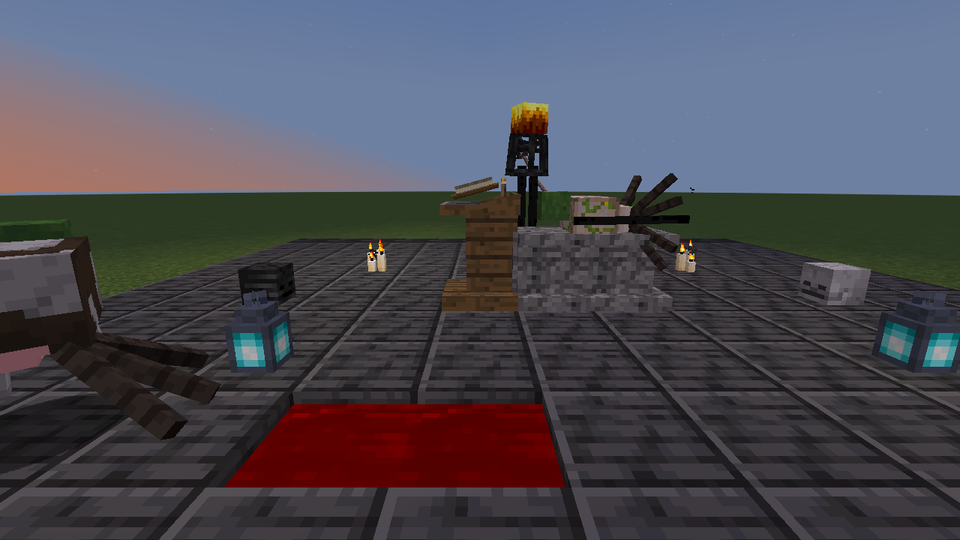

</div>

---

**Necromancy** is a port of sirolf2009's and AtomicStryker's classic 1.7.10 mod to Minecraft 1.21.1.
Everything the original did still works. A design review then took it further: every body part
now *does* something, you command your undead, they work and rank up, and an endgame boss is waiting.

<table>
<tr>
<td width="50%">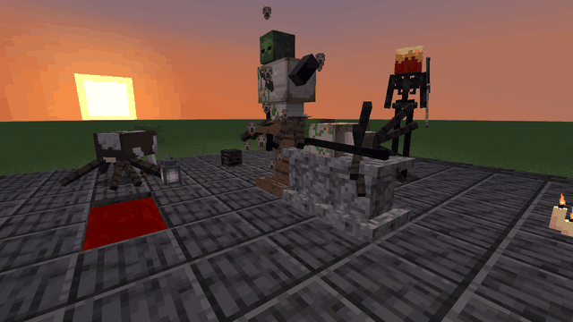</td>
<td width="50%">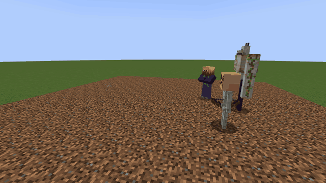</td>
</tr>
<tr>
<td align="center"><b>Raise them</b> on the Summoning Altar</td>
<td align="center"><b>Command them</b> to fight, guard, patrol and work</td>
</tr>
</table>

## Contents

- [The art in five steps](#the-art-in-five-steps)
- [Any creature, any body](#any-creature-any-body)
- [OreSpawn's creatures](#orespawns-creatures)
- [The Sewing Machine](#the-sewing-machine)
- [The Summoning Altar and the shrine](#the-summoning-altar-and-the-shrine)
- [Commanding the dead](#commanding-the-dead)
- [The Rite of the Abomination](#the-rite-of-the-abomination)
- [The world](#the-world)
- [Commands and configuration](#commands-and-configuration)
- [Português do Brasil](#português-do-brasil)
- [Building from source](#building-from-source)
- [Credits and license](#credits-and-license)

## The art in five steps

1. **Craft the Necronomicon** from leather, a book, a feather, an ink sac, nether wart and a Jar of Blood.
   Right-click to read it: it is a 12-page guide to everything below.
2. **Harvest.** Creatures you or your Minions kill drop **organs**: brains, hearts, lungs, muscle and skin.
   Some are richer in one organ than others; a ghast is mostly lung. A **Bone Needle** draws a Jar of Blood
   from a living creature. A killing blow with a **scythe** catches its soul in an empty bottle.
3. **Sew** heads, torsos, arms and legs on the 4x4 **Sewing Machine**.
4. **Bind an altar.** Put planks down with two cobblestone in a row beside them, then use the Necronomicon on
   the planks.
5. **Raise.** Lay the body on the altar with blood and a soul, then sneak-use it or press **Raise**.

<div align="center">
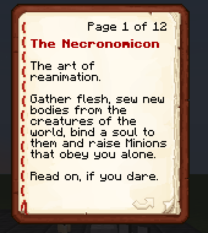
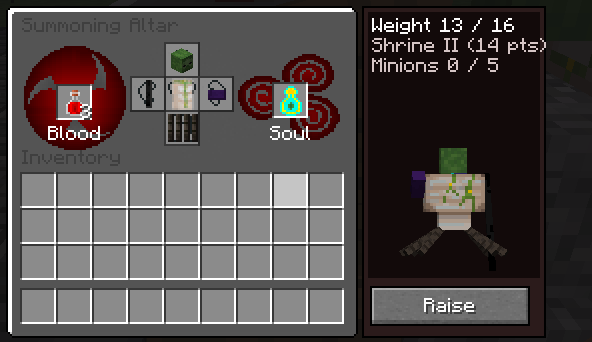
</div>

## Any creature, any body

Twenty-eight creatures lend their bodies:

- **The 17 from the original:** Cave Spider, Chicken, Cow, Creeper, Enderman, Iron Golem, Isaac, Pig,
  Zombified Piglin, Sheep, Skeleton, Spider, Squid, Villager, Witch, Wolf and Zombie.
- **Ten modern ones:** Husk, Drowned, Bogged, Wither Skeleton, Blaze, Slime, Mooshroom, Snow Golem, Armadillo
  and Goat.
- **The Night Crawler**, the mod's own creature.

Every part is cut from the creature's own vanilla model, so it matches its texture exactly. The tooltip tells you
what a part adds.

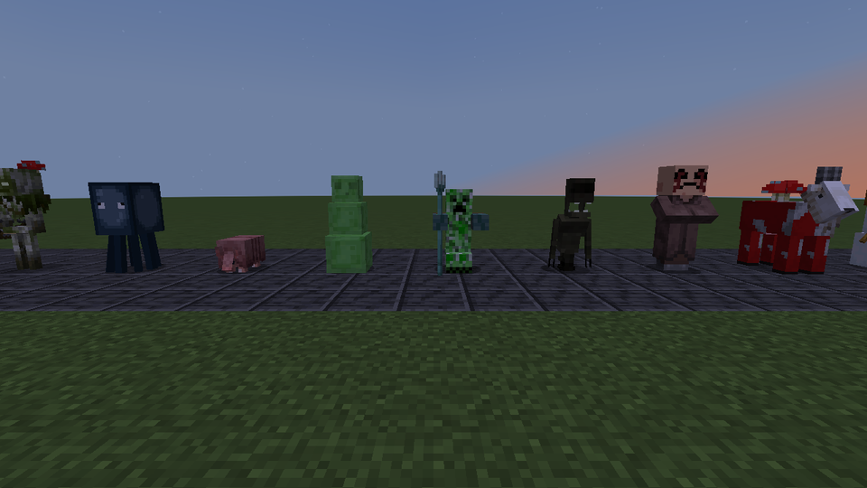

**Every part has a trait.** A few examples:

| Part | Trait |
|---|---|
| Cave Spider head | Venom: every hit poisons |
| Enderman head | Blink: teleports beside a distant target |
| Iron Golem arms | Golem Toss: flings what they hit into the air |
| Witch arms | Throw Slowness, Weakness and Poison potions |
| Creeper torso | Explodes when the Minion dies (a lightning-charged one twice as hard) |
| Blaze head | Fireball volleys |
| Chicken torso | Lays eggs |
| Cow torso | Milkable |
| Sheep torso | Shearable |
| Spider legs | Climb walls |
| Wolf head | Pack Hunter: hits harder beside other wolf-headed Minions |

Some parts carry a downside too: undead heads burn in daylight unless the Minion wears a helmet, and
Enderman and Blaze parts hate water.

<div align="center">
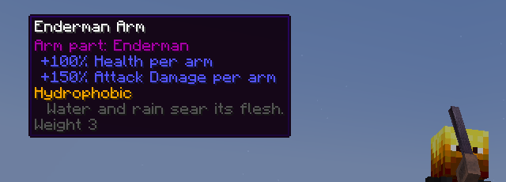
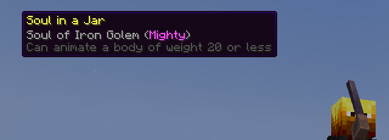
</div>

**Souls have weight.** A soul remembers what it was reaped from. A chicken's soul can lift a light body; an
Iron Golem's can lift almost anything. Heavy builds are a late-game reward, not a free win.

## OreSpawn's creatures

With [OreSpawn](https://github.com/CoolFreeze23/Orespawn) installed, **97 of its creatures** lend their bodies too:
**314 parts**, from the T-Rex's skull and the Dragon's wings to an ant's six legs. Each part is cut from the
creature's own model and drawn with its own texture, and the parts fit any other creature's, OreSpawn's or vanilla's.

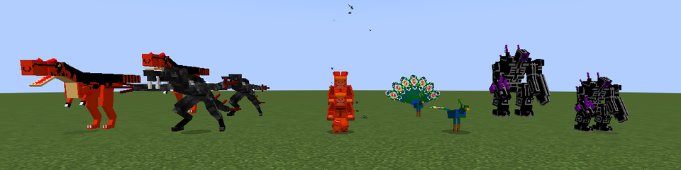

What OreSpawn's creatures do comes with their parts:

- **Strikes and senses.** Poisonous, burning and tossing bites, disarming claws, cobwebs that clear away on their own,
  banes against sea creatures, arthropods and fliers, charges and pounces.
- **Ranged parts.** The robots' lasers and the dragons' fire, plus acid, water and ink, each shot drawn as OreSpawn's
  own projectile.
- **Gliding wings** on 24 creatures, which glide their Minion down slowly.
- **Mounts.** Saddle a torso and steer with the movement keys. The Ostrich, Dragon, Leonopteryx and Cephadrome have
  a horse's jump bar. The Camarasaurus seats two, and so does the Whale, which swims.
- **New jobs.** The Beaver fells trees under the Work order and the Molenoid digs. The **Ender Reaper's arms bottle
  the soul of everything they kill**, as a scythe does.
- **Broods.** The Emperor Scorpion and the Trooper Bug call small temporary spawnlings into the fight.
- **Hides.** Thorny, cactus-proof, water-breathing, glowing in the dark, self-mending, or a shell that clams shut.

<div align="center">
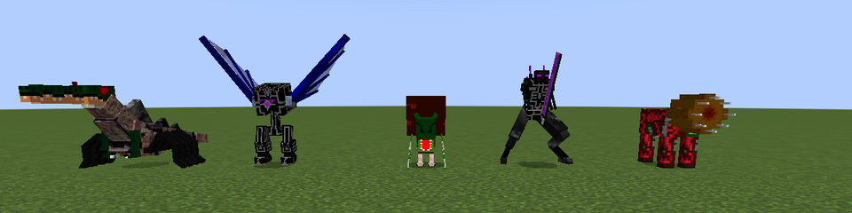
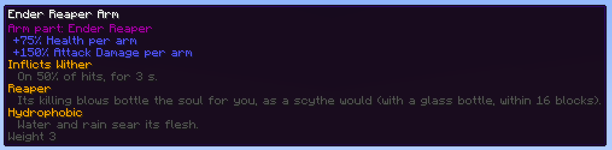
</div>

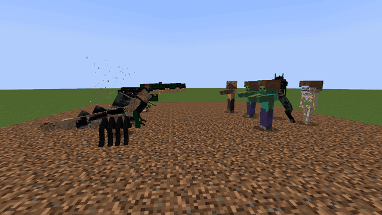

How it works:

- **Recipes and names.** The parts are sewn from each creature's own drops on the Sewing Machine. JEI lists every
  recipe. Creature names follow OreSpawn's English and the CrazyCraft pack's Brazilian Portuguese.
- **Soul potency.** OreSpawn's creatures have far more health than vanilla ones, so their health counts half
  (`oreSpawnSoulHealthFactor`).
- **Optional.** Without OreSpawn, none of this loads and nothing is missing.
- **Resource packs.** Every part, OreSpawn's or vanilla's, is drawn from the creature's own texture and model files.
  A resource pack that retextures a creature retextures its Minion parts as well, as long as it keeps the model's bone
  names.

The design is in [`docs/ORESPAWN_REVIEW.md`](docs/ORESPAWN_REVIEW.md).

## The Sewing Machine

Put a Bone Needle and String in the machine, and stitch parts from organs, skin, bones and each creature's own
essence: rotten flesh for a zombie, an ender pearl for an enderman, and so on. Every stitch uses a string and
wears the needle down. With [JEI](https://www.curseforge.com/minecraft/mc-mods/jei) installed, every pattern
appears there.

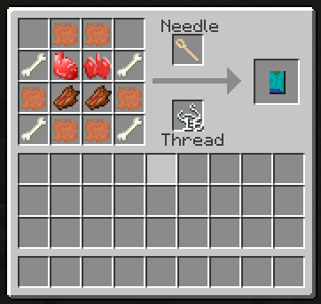

## The Summoning Altar and the shrine

The altar shows the body lying on its table as you build it. Its side panel shows three numbers:

- the body's **weight** against the soul's strength
- the **shrine** tier
- how many Minions you keep

The dead are drawn to dark places. **Lit candles, soul lights, pools of blood and mob heads** within four blocks of
the altar raise its shrine tier, and each tier lets you keep more Minions: 3, 5 or 8.

## Commanding the dead

- **The Bone Scepter** selects your Minions and gives them orders:
  - **Follow**
  - **Stay**
  - **Guard** a spot
  - **Patrol** a route of up to four points
  - **Work** at a chest

  It also sets their stance: **Passive**, **Defensive** or **Aggressive**.
- **Equip them.** Sneak-click a Minion with an empty hand to open its screen. Give it armour, weapons and a
  saddle. Skeleton arms draw bows, Bogged arms shoot poison, Drowned arms throw tridents.
- **Ride them.** Saddle a pig, cow, spider or squid torso and steer with the **Brain on a Stick**.
- **Put them to work:**
  - a villager head with a hoe farms
  - two Enderman arms collect items
  - a scythe in hand culls your herds and bottles the souls
- **They grow stronger.** Kills earn ranks, from Fresh Corpse to **Revenant**.
- **They can come back.** Bind a Minion to a **Phylactery**. If it dies it leaves Remains, and the altar raises it
  again with its name and kills.

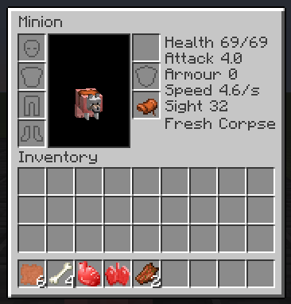

## The Rite of the Abomination

At a tier III shrine, at night or in a storm, put an **Ominous Bottle** and a Jar of Blood on an empty altar.
What answers is no servant. The Abomination is stitched from the heaviest parts there are and has 300 health. As
it weakens it tears off parts and raises the dead around it. Kill it for a **Legendary** soul.

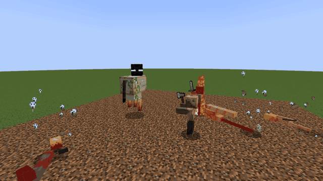

## The world

- **Village cemeteries:** graves to brush for organs and parts, a tomb with chests, and the **Necromancer**
  villager, whose job site is the Sewing Machine.
- **Nether Chalices:** towers of nether brick standing in lava lakes, their cups full of blood.
- **Night Crawlers** stalk the night. **Isaac** cries in the deep: beat him three times to claim his head, which
  you can wear to weep tears at your foes.

<div align="center">
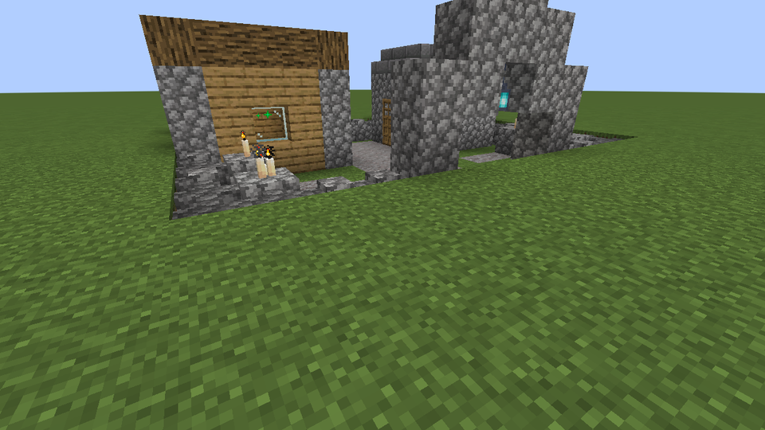
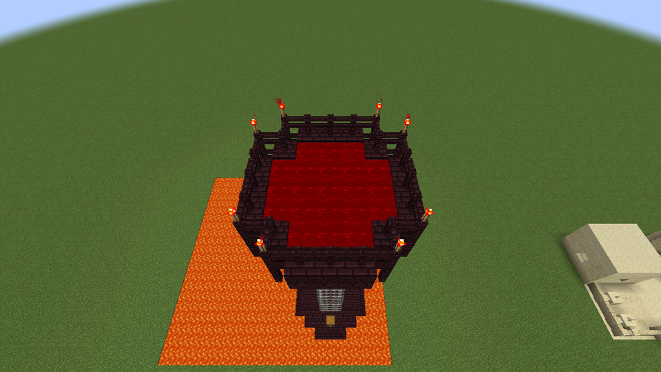
</div>

## Commands and configuration

| Command | |
|---|---|
| `/minion set aggressive\|passive` | Attack every player who is not a friend, or only enemies |
| `/minion friend\|enemy\|forget <player>` | Your Minions' standing orders about a player |
| `/minion sit\|follow` | Order every Minion of yours nearby |
| `/minion list` | Your orders and how many Minions you keep |

`config/necromancy-common.toml` has these settings:

- spawn rarity of Night Crawlers and Isaac
- shrine tiers, or a flat Minion limit
- soul potency on or off
- organ drop rate
- whether a Creeper torso breaks blocks
- how much of an OreSpawn creature's health counts towards its soul's potency
- `classicStats`, which restores the exact 1.7.1 numbers

## Português do Brasil

The mod is fully translated into Brazilian Portuguese, written as if it had been made in Portuguese, using
Minecraft's own names for every vanilla creature and item. The Necronomicon guide, every trait and every message
are translated.

## Building from source

```bash
./gradlew build          # the mod jar, in build/libs
./gradlew runData        # regenerates models, recipes, loot, tags, advancements and both languages
./gradlew runGameTestServer
```

To run the OreSpawn GameTests too, put the OreSpawn and GeckoLib jars in `runmods/` and add `-PwithOreSpawn`.

- **Requirements:** Java 21, NeoForge 21.1.
- **Data:** generated data lives in `src/generated/resources`. Hand-written texts (the guide, feature texts) are
  in `src/main/lang-src`.
- **Translations:** `tools/check_lang.py` proves that every key the code uses exists in both languages.
- **Further reading:** `docs/PORTING.md` describes what was carried over, fixed and added. `docs/REVIEW.md` is
  the design review behind the new features.

## Credits and license

- **Original mod:** [sirolf2009](https://github.com/sirolf2009/Necromancy) (Necromancy and the NecroAPI,
  LGPL-3.0), maintained for 1.6–1.7 by [AtomicStryker](https://github.com/AtomicStryker/atomicstrykers-minecraft-mods).
- **Original models and textures:** Mr_boness, Fabiulu and TheBlackPixel.
- **NeoForge 1.21.1 port:** CoolFreeze23.

This source is distributed under the **GNU LGPL-3.0** (see `LICENSE`), like sirolf2009's original. AtomicStryker's
1.7.10 changes fall under his own license, which does not allow compiled builds to be redistributed, so this
repository publishes **source only**. Build it yourself for personal use.

Not affiliated with Mojang or Microsoft.
